# MDView 3.9.7

**A Markdown viewer plugin for Total Commander.**

Press `F3` on any `.md` file and get a clean, fully rendered preview with dark mode, syntax highlighting, table of contents, upgraded find-in-page controls, split view, and built-in Mermaid support.


---

## Windows XP Build

The repository includes a dedicated `ReleaseXP|Win32` Visual Studio configuration that produces `mdview_xp.wlx`.

- It targets Windows XP SP3 with `_WIN32_WINNT=0x0501`
- It uses the `v141_xp` toolset, Windows 7.1A SDK, and the 10.0.10240 Universal CRT
- It links the runtime statically. The Lister package contains `mdview_xp.wlx` and its XP-specific installer entry
- Mermaid blocks appear as fenced source on XP
- The XP build is 32-bit only

## Screenshots

| Light Mode                                | Dark Mode                               |
| ----------------------------------------- | --------------------------------------- |
| 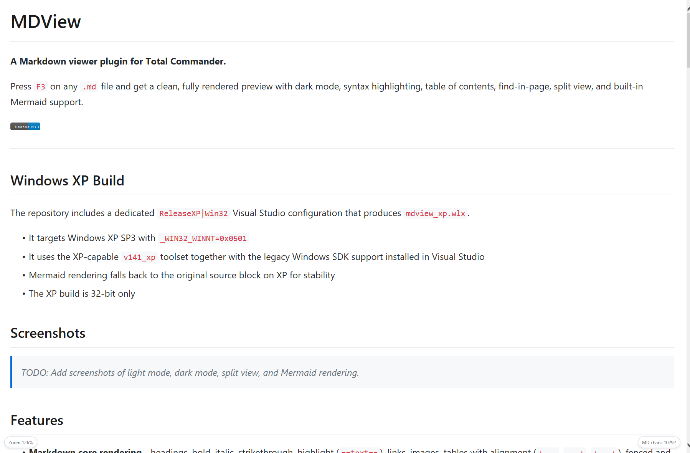 | 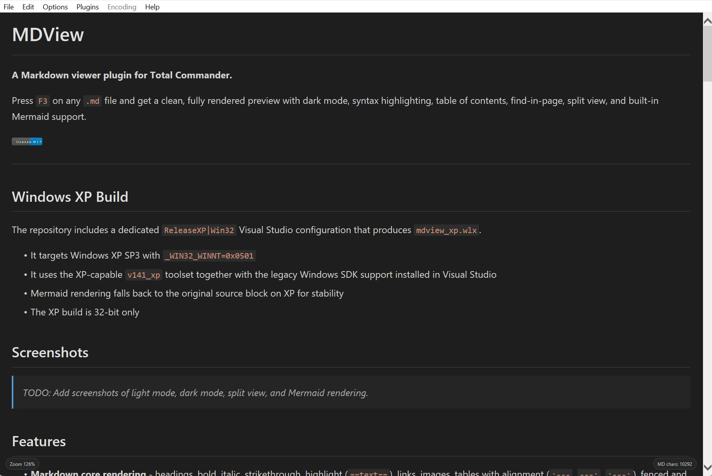 |

| Split View                                | Table of Contents                     |
| ----------------------------------------- | ------------------------------------- |
| 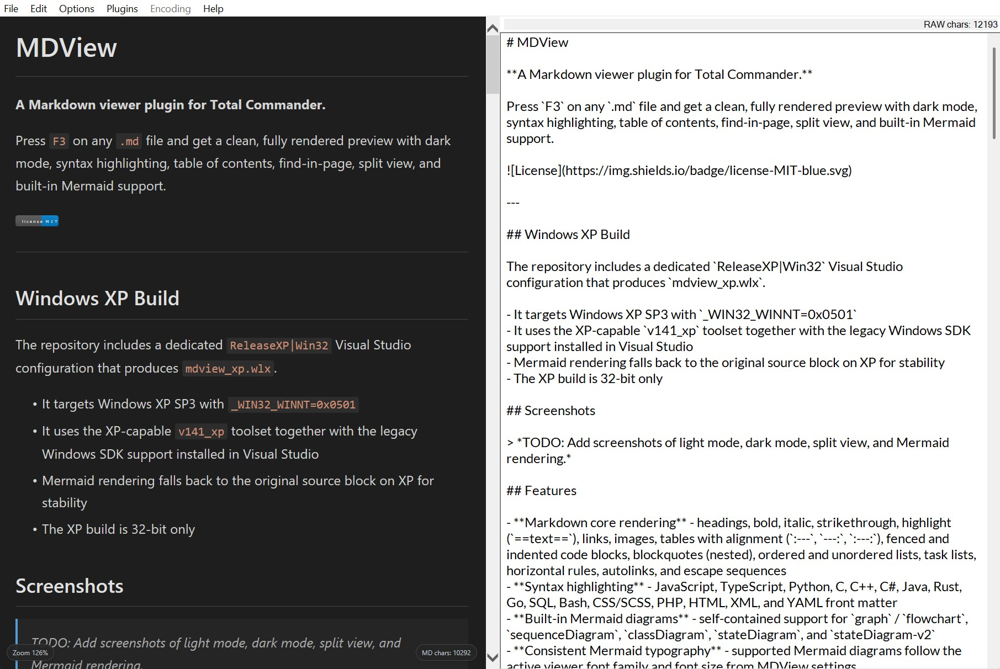 | 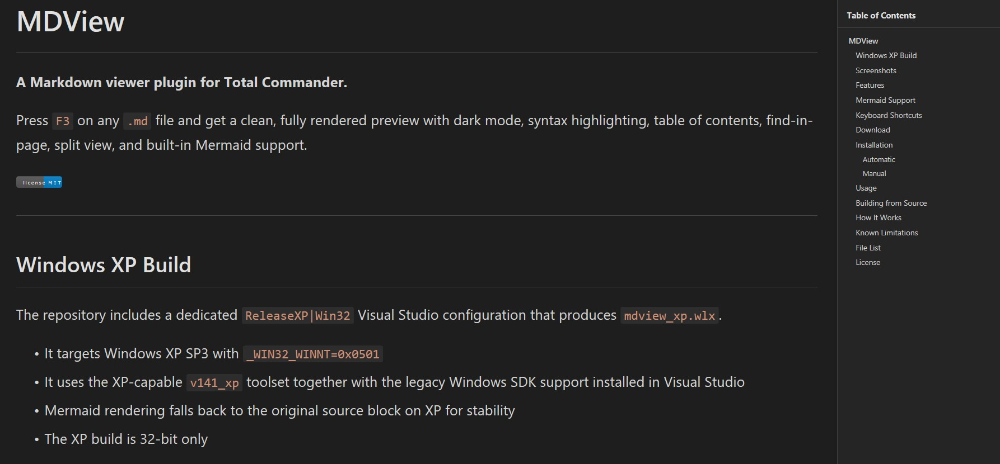 |

| Help View                               | Mermaid Rendering 1                                         |
| --------------------------------------- | ----------------------------------------------------------- |
| 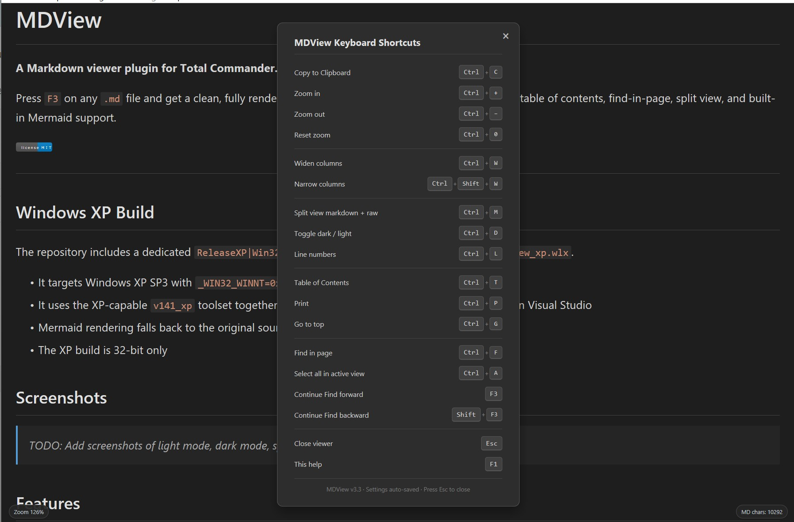 | 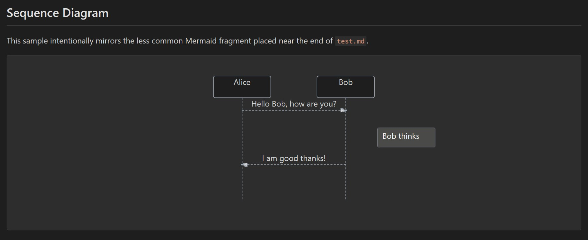 |

| Mermaid Rendering 2                                         | Mermaid Rendering 3                                         |
| ----------------------------------------------------------- | ----------------------------------------------------------- |
| 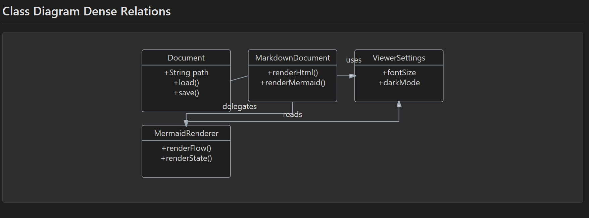 | 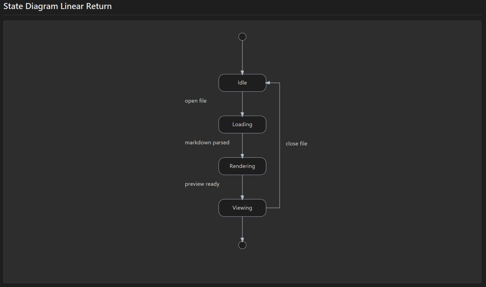 |

| Search in Split view | Packet diagram |
| --- | --- |
| 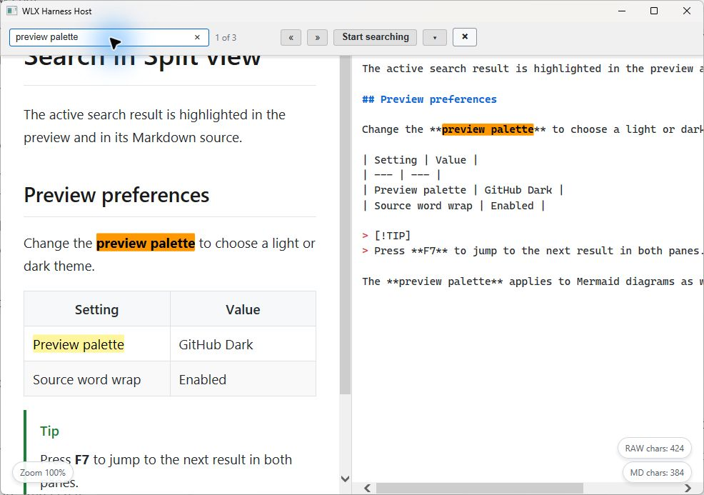 | 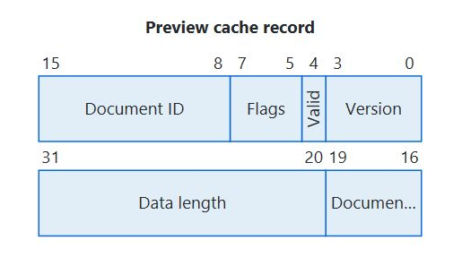 |

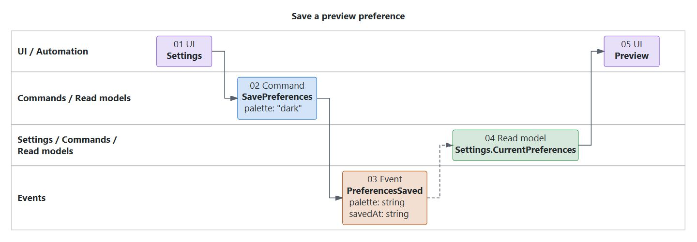

## Features

- **Markdown core rendering** - headings, bold, italic, strikethrough, highlight (`==text==`), links, images, tables with alignment (`:---`, `---:`, `:---:`), fenced and indented code blocks, blockquotes (nested), ordered and unordered lists, task lists, horizontal rules, and escape sequences
- **GitHub extensions** - numbered footnotes with backlinks, all five alert types, and angle-bracket or bare autolinks for HTTP, HTTPS, FTP, email addresses, Mailto, and XMPP.
- **Document encodings** - UTF-8, UTF-16 LE/BE, and Windows-1252. BOM-less UTF-16 is inferred from its byte pattern. Files without a BOM or clear UTF-16 pattern are read as UTF-8 when valid, with Windows-1252 as the fallback.
- **Syntax highlighting** - JavaScript, TypeScript, Python, C, C++, C#, Java, Rust, Go, SQL, Bash, CSS/SCSS, PHP, HTML, XML, JSON/JSONC, diff, and YAML front matter
- **Built-in Mermaid diagrams** - self-contained support for flowcharts, sequence, class, state, entity relationship, requirement, Gantt, timeline, Git graph, mind map, radar, treemap, Venn, packet, ZenUML, Event Modeling, and Ishikawa diagrams
- **Consistent Mermaid typography** - supported Mermaid diagrams follow the active viewer font family and font size from MDView settings
- **Emoji shortcode support** - a curated set of common shortcodes such as `:smile:`, `:heart:`, `:+1:`, `:rocket:`, `:warning:`, `:white_check_mark:`, and similar everyday aliases
- **Color themes** - follow Windows or Total Commander, force light or dark, and choose separate light and dark palettes
- **Selectable math** - renders common TeX expressions in inline and display math
- **Adjustable layout** - zoom up to 500% with keyboard shortcuts or `Ctrl+MouseWheel`. Split view scales the preview and source together
- **Line numbers** - toggle on code blocks with `Ctrl+L`
- **Table of Contents** - auto-generated sidebar from headings
- **Find in page** - compact advanced search with match highlighting, whole-word, case-sensitive, live search, and optional explicit start-search mode
- **Tooltip on links** - hovering a link shows the resolved target URL
- **Relative link and image handling** - local Markdown links, Markdown images, and HTML `` paths resolve against the current document. HTML images retain their declared dimensions and paragraph alignment.
- **Full character filename support** - Markdown files whose names contain accented, symbolic, or non-ASCII characters open through the Unicode Windows file API instead of falling back to Total Commander's plain-text viewer
- **Safe link opening** - linked Markdown files open inside MDView instead of blanking the embedded browser; other links are handed off to Windows
- **YAML front matter rendering** - top-of-file `--- ... ---` metadata blocks in SKILL-style documents render as highlighted YAML instead of ordinary paragraph text
- **Compact changelog readability** - consecutive plain-text entries such as `-add:` and `-fix:` retain visible line breaks in rendered documents
- **Preview, Code, and Split view** - show the rendered document with `Ctrl+1`, its Markdown source with `Ctrl+2`, or both panes with `Ctrl+M`. Search keeps the active result visible in both panes
- **Source word wrap** - toggle with `Ctrl+W` in Code or Split view. The `WordWrap` setting under `[MDView]` remembers the preference. Code view highlights Markdown headings, list and quote markers, inline code, and fenced C/C++, JSON/JSONC, and diff.
- **Character count with spaces** - both rendered and raw views show a character count aligned to a Word-like convention that excludes line breaks
- **Split-view positioning** - rendered HTML and raw Markdown panes keep independent scroll positions so manual reading does not jump unexpectedly
- **Manual split-view alignment** - use `Ctrl+Y`, double click, or the `Sync panes here` context-menu command for source-line alignment from the focused pane
- **Smart clipboard behaviour**
  - Copy from rendered view -> formatted HTML + plain text
  - Copy from raw view -> original Markdown text
- **TC copy as text support** - Total Commander "Copy as text" exports only the rendered markdown text, without the viewer status overlays
- **Expand / collapse** - long code blocks and blockquotes are collapsed by default with a "Show more" button
- **Raw HTML collapsible sections** - block-level `<details>` / `<summary>` sections are preserved, with a viewer fallback for older MSHTML engines that do not implement native HTML5 details controls
- **Persistent settings** - font size, theme, line numbers, and raw view settings are saved and restored between sessions
- **Print support** - `Ctrl+P` renders a clean printable version
- **Progress bar** - subtle reading position indicator at the top of the viewport
- **Full window resize** - content fills the viewport correctly when the lister window is resized or maximised
- **Respect Total Commander interaction patterns** where applicable. Keys `1..9`, `N`, and `P` are forwarded according to the lister concept, `F3` / `Shift+F3` continue in-page search, `F7` opens search or advances an existing query, and TC menu commands such as Copy, Select all, Print, and scroll-percent are wired through the WLX command callbacks
- No temporary HTML files are created; everything stays in memory
- Support for mixed Markdown and HTML content

## Mermaid Support

Mermaid rendering is built directly into the plugin and is fully self-contained inside the `.wlx` and `.wlx64` binaries. No external JavaScript files are required in the distribution.

Currently supported Mermaid diagram types:

- `graph` / `flowchart`
- `sequenceDiagram`
- `classDiagram`
- `stateDiagram`
- `stateDiagram-v2`
- `erDiagram` with entity aliases, attributes, keys, comments, and crow's-foot cardinalities
- `requirementDiagram` with SysML requirement types, elements, fields, and all seven relationship types
- `gantt` with date and time axes, sections, dependencies, excluded dates, task statuses, and milestones
- `timeline` with sections, multiple events per period, line breaks, and left-to-right or top-down layout
- `gitGraph` with branch lanes, branch ordering, checkout, merges, cherry-picks, tags, commit shapes, and LR/TB/BT layouts
- `mindmap` with indentation-based nesting, six node shapes, wrapped labels, and colored branches around a central root
- `radar-beta` with named axes, multiple series, keyed or positional values, scale bounds, tick marks, and a legend
- `treemap-beta` with nested sections and value-proportional rectangles
- `venn-beta` with up to six sets, sized circles and pairwise overlaps, multi-set overlaps, and labels inside regions or below the diagram
- `packet` and `packet-beta` with absolute bit positions and ranges, relative `+count` widths, and fields that span rows
- `zenuml` with participants, aliases, asynchronous messages, nested calls, creation, replies, and control fragments
- `eventmodeling` with time and reset frames, namespace swimlanes, inferred and explicit source links, and inline or referenced data
- `ishikawa-beta` with an effect and indentation-based cause branches

Flowcharts, class, state, entity relationship and requirement diagrams use layered layout with separate ports and lanes for long links and cycles. Sequence diagrams keep participant order and reserve space for messages and notes. The renderer measures the resulting SVG, includes padding for strokes and arrowheads, and scales it to the preview width.

These are subsets of the corresponding grammars. Unsupported diagram types and unrecognised statements fall back to fenced source. ER subgraphs and diagram-specific styling are outside the supported subset. Diagram labels use plain text. Pie charts, XY charts, Sankey and other grammars need separate layout or rendering. See the [Mermaid syntax catalogue](https://mermaid.js.org/intro/syntax-reference.html) for the full list.

Gantt accepts `YYYY-MM-DD` (optionally with `HH:mm` or `HH:mm:ss`), time-only formats, and numeric timestamps (`X`/`x`). It supports common axis labels and fixed tick intervals from milliseconds to weeks. Mermaid front matter, custom styling, calendar-based tick intervals, and task click actions are outside the supported subset.

Git graphs use the default `main` branch and display commits in source order. Mind map labels support `<br>` line breaks. External icon and class annotations are accepted on their own lines and have no visual effect. Markdown formatting inside diagram labels and Mermaid configuration directives are outside the supported subset.

Radar, Treemap, and Venn accept title-only front matter. Their custom styles and theme configuration are outside the supported subset. Venn sizes guide the circle layout and pairwise overlaps. Higher-order overlap areas and overconstrained layouts are approximate.

Packet accepts `bitsPerRow`, `showBits`, and `bitOrder` under `config.packet` in Mermaid front matter. ZenUML uses the built-in sequence renderer with text captions for participant annotations. Its statements are line-oriented, and top-level calls with no named sender use a Caller lane. Event Modeling displays data as text, with the full payload available in a tooltip.

The dedicated Windows XP build displays fenced Mermaid source.

## Math

Use `$…$` for inline math and `$$…$$` on one line or on separate delimiter lines for display math. The HTML renderer supports fractions, square roots, subscripts, superscripts, sums, integrals, common Greek letters and operators, and display tags such as `\tag{2}`. Formulas remain selectable, and unsupported expressions retain their source. The renderer is self-contained and does not require MathML, JavaScript, or downloaded fonts.

## Color settings

Right-click the preview and open **Color theme** to choose the mode and the light and dark palettes. **Built-in** restores the default palette for the selected mode. **Ctrl+D** switches to the opposite fixed mode and saves it.

Set the same options in the plugin INI under `[MDView]`:

```ini
[MDView]
; 0 = follow Windows (default)
; 1 = always light
; 2 = always dark
; 3 = follow Total Commander
colorTheme=3
lightTheme=github-light.json
darkTheme=github-dark.json
```

Existing `DarkMode=0` and `DarkMode=1` settings are used when `colorTheme` is absent. Total Commander mode uses the WLX dark-mode flag and responds to host notifications. Windows mode reads the Windows app theme when available and uses light mode on XP.

Keep the `Themes` folder beside the installed plugin. Palettes use the existing VS Code-style JSON with comments. MDView reads `type`, supported `colors` and syntax `tokenColors`. The optional `mdview.*` keys in `colors` accept hexadecimal colors and override these elements:

| Keys | Elements |
| --- | --- |
| `markBackground`, `markForeground` | Markdown `==highlight==` and Mermaid notes |
| `findBackground`, `findForeground`, `findActiveBackground`, `findActiveForeground` | Search matches and the active match |
| `headingForeground`, `codeBackground`, `codeForeground`, `border`, `mutedForeground` | Document and code styling |
| `mermaidBackground`, `mermaidNodeBackground`, `mermaidEdge` | Diagram canvas, nodes and connectors |

## Keyboard Shortcuts

| Shortcut           | Action                            |
| ------------------ | --------------------------------- |
| `Ctrl` `+`         | Zoom in                           |
| `Ctrl` `-`         | Zoom out                          |
| `Ctrl` `MouseWheel`| Zoom in / out                     |
| `Ctrl` `0`         | Reset zoom                        |
| `Ctrl` `D`         | Toggle dark / light mode          |
| `Ctrl` `L`         | Toggle line numbers               |
| `Ctrl` `T`         | Table of Contents                 |
| `Ctrl` `F`         | Find in page                      |
| `Ctrl` `P`         | Print                             |
| `Ctrl` `G`         | Go to top                         |
| `Ctrl` `1`         | Show rendered Preview             |
| `Ctrl` `2`         | Show Markdown Code                |
| `Ctrl` `W`         | Toggle source word wrap            |
| `Ctrl` `M`         | Toggle split view                 |
| `Ctrl` `Y`         | Sync split panes here             |
| `Ctrl` `A`         | Select all in active view         |
| `Ctrl` `C`         | Copy selection                    |
| `F3`               | Find next                         |
| `Shift` `F3`       | Find previous                     |
| `F7`               | Open find, or find next when the bar already has a query |
| `Esc`              | Close find bar, TOC, or help; otherwise close viewer |
| `F1`               | Show shortcut reference           |

Press `F1` inside the viewer for an on-screen reference.

## Version

Source version is **MDView 3.9.7**.

## Download

Use the [Releases page](../../releases) to choose the package for your system.

| Package | Plugin files |
| --- | --- |
| `WLX_mdview_TC-plugin_v3.9.7.zip` | `mdview.wlx` for 32-bit Total Commander and `mdview.wlx64` for 64-bit Total Commander |
| `WLX_mdviewXP_TC-plugin_v3.9.7.zip` | `mdview_xp.wlx` for 32-bit Total Commander on Windows XP SP3 |

## Installation

### Automatic

Open the downloaded `.zip` file inside Total Commander. The included `pluginst.inf` triggers the automatic plugin installer.

### Manual

1. Extract the plugin binary for your system and the adjacent `Themes` folder to a directory of your choice.
2. In Total Commander open **Configuration -> Options -> Plugins -> Lister (WLX) -> Add**.
3. Select the `.wlx` / `.wlx64` file.
4. The detect string auto-configures for `.md`, `.markdown`, `.mkd`, and `.mkdn` extensions.

## Usage

1. Navigate to any Markdown file in Total Commander.
2. Press `F3` to open the lister.
3. Use the keyboard shortcuts to customise the view. Preferences are saved automatically.

For Mermaid validation, use `test_mermaid.md`. It covers the Mermaid diagram families currently supported by MDView. For a broad Markdown regression sample, use `test.md`.

For relative-link and front-matter regression checks, use `Sample_md_files\readme_problematic.md`.

For filename regression checks, MDView includes local-only full-character filename coverage in the development samples. Distribution ZIPs intentionally keep the packaged sample filenames simple.

For collapsible-section regression checks, use `Sample_md_files\markdown_en.md`.

For embedded-image regression reference, use `Sample_md_files\file_with_embedded_image.md` to verify the current unsupported case documented below.

## Building from Source

The plugin is implemented in C and built on Windows with MSVC. The `.inc` files are compiled into the plugin and require no separate runtime installation.

The raw Markdown view is rendered inside the embedded MSHTML document as a synchronized source pane, so split view uses a single browser document instead of a separate RichEdit control.

Visual Studio configurations:

- `Release|Win32` - modern 32-bit build (`mdview.wlx`)
- `Release|x64` - modern 64-bit build (`mdview.wlx64`)
- `ReleaseXP|Win32` - Windows XP-compatible 32-bit build (`mdview_xp.wlx`)

The `ReleaseXP|Win32` configuration targets `_WIN32_WINNT=0x0501`. Install the **C++ Windows XP Support for VS 2017 (v141) tools** component in a Visual Studio instance that offers it. See [Microsoft's Windows XP build setup](https://learn.microsoft.com/en-us/cpp/build/configuring-programs-for-windows-xp).

The project also includes `resource.rc` and `resource.h`, so the Win32, x64, and XP binaries embed Windows file version metadata directly.

## Preparing and Publishing a Release

Run these commands on a supported Windows build machine with a standard user account.

| Command | Result |
| --- | --- |
| `publishme.bat --package` | Builds Win32 and x64 and creates the standard plugin ZIP in `Distribution`. |
| `publishme.bat --package-xp` | Builds both ZIPs. The XP build requires `v141_xp`, and packaging checks that its binary is 32-bit and targets OS and subsystem version 5.01. |
| `publishme.bat --check` | Clones GitHub `main` to a temporary folder and displays the exact staged source diff summary. |
| `publishme.bat` | Commits the selected release source files and pushes to GitHub `main`. Requires Git for Windows, a configured Git identity, and credentials with push access. |

If an XP toolchain is staged outside Visual Studio, run `powershell.exe -File tools\mdview-release.ps1 -Action Package -IncludeXP -XPToolchainRoot <path>`. The root contains `targets` with the v150 MSBuild targets and `v141_xp` Win32 toolset files, `sdk` with Windows 7.1A, and `ucrt` with the 10.0.10240 headers and x86 libraries. The selected Visual Studio instance supplies the 14.16.27023 compiler.

1. Run `publishme.bat --check` and review the staged file summary.
2. Run `publishme.bat` to commit and push the source to GitHub `main`.
3. Create the GitHub release for the resulting commit and attach both version-matched ZIPs from `Distribution`. Use the corresponding version section of `CHANGELOG.txt` for the release notes.

The publisher starts from the current remote branch, stages an explicit list of release files in a temporary checkout, and uses a fast-forward push. A source snapshot is enough to run it.

## How It Works

MDView is a WLX lister plugin that Total Commander loads when you press `F3` on a matching file type. The Unicode `ListLoadW` entry point converts the incoming Windows path to the plugin's internal UTF-8 path representation; file reads convert that UTF-8 path back to UTF-16 and use `_wfopen`, so accented filenames are opened by the Windows Unicode API. It contains a built-in Markdown-to-HTML converter and embeds an MSHTML WebBrowser control to render the output. Keyboard input is handled by subclassing the browser's internal window, giving reliable hotkey interception without interfering with normal scrolling or Total Commander key handling. The OLE control and its child window hierarchy are resized via `IOleInPlaceObject::SetObjectRects` and `MoveWindow` so the viewer fills the lister window at any size. Settings are persisted via the standard Total Commander INI mechanism.

## Known Limitations

MDView implements a subset of CommonMark and GitHub Markdown in the built-in parser.

- **Math uses a TeX subset.** Supported formulas are rendered as selectable HTML. Unsupported commands remain visible as source.
- **Emoji shortcode support is curated, not exhaustive.** Common shortcodes are supported, but MDView does not ship a full GitHub-style emoji catalog.
- **Reference-style image and link definitions are limited.** Inline links/images are the primary supported path. Sample cases such as embedded `data:` image references at the end of the document are not fully supported.
- **Raw HTML passthrough is selective.** Supported containers include `<table>`, `<details>`, `<p>`, `<div>`, `<center>` and `<figure>`. Common inline HTML such as `<kbd>`, `<sub>`, `<sup>` and `` is also passed through.
- **`<details>` support may use a viewer fallback.** On older MSHTML engines, collapsible sections are emulated in script rather than provided natively by the browser control.
- **Mermaid support is intentionally partial.** See [Mermaid Support](#mermaid-support) for the supported diagram families. Other Mermaid syntaxes fall back to the original source block.
- **Mermaid on Windows XP.** XP builds show Mermaid blocks as fenced source.
- **Directives such as `[TOC]` and footnotes are not fully implemented.** They may render as ordinary text rather than as generated navigation or note structures.
- **Compact changelog entries are a readability extension.** Lines such as `-add:` and `-fix:` render on separate lines when consecutive; use standard `- item` syntax when portable Markdown list semantics are required.
- **The parser is not a full spec-compliance engine.** Edge cases involving deeply nested emphasis, exotic HTML/Markdown interactions, or advanced extension syntax may differ from CommonMark/GFM behavior.

## File List

| File              | Description                                                                                        |
| ----------------- | -------------------------------------------------------------------------------------------------- |
| `mdview.c`        | Complete plugin source                                                                             |
| `mdview.def`      | DLL export definitions                                                                             |
| `resource.rc`     | Windows version resource embedded into the generated WLX binaries                                  |
| `resource.h`      | Shared version-number macros used by the resource script                                           |
| `pluginst.inf`    | Total Commander auto-install manifest                                                              |
| `test.md`         | Broad Markdown regression and feature sample                                                       |
| `test_mermaid.md` | Dedicated Mermaid sample document covering the Mermaid diagram types currently supported by MDView |

## License

[MIT](LICENSE)
