# Mermaid Support Test File

This document exercises every Mermaid diagram type currently supported by MDView.

The current built-in renderer supports:

- `graph` / `flowchart`
- `sequenceDiagram`
- `classDiagram`
- `stateDiagram` / `stateDiagram-v2`
- `erDiagram`
- `requirementDiagram`
- `gantt`
- `timeline`
- `gitGraph`
- `mindmap`
- `radar-beta`
- `treemap-beta`
- `venn-beta`
- `packet` / `packet-beta`
- `zenuml`
- `eventmodeling`
- `ishikawa-beta`

## Flowchart Top To Bottom

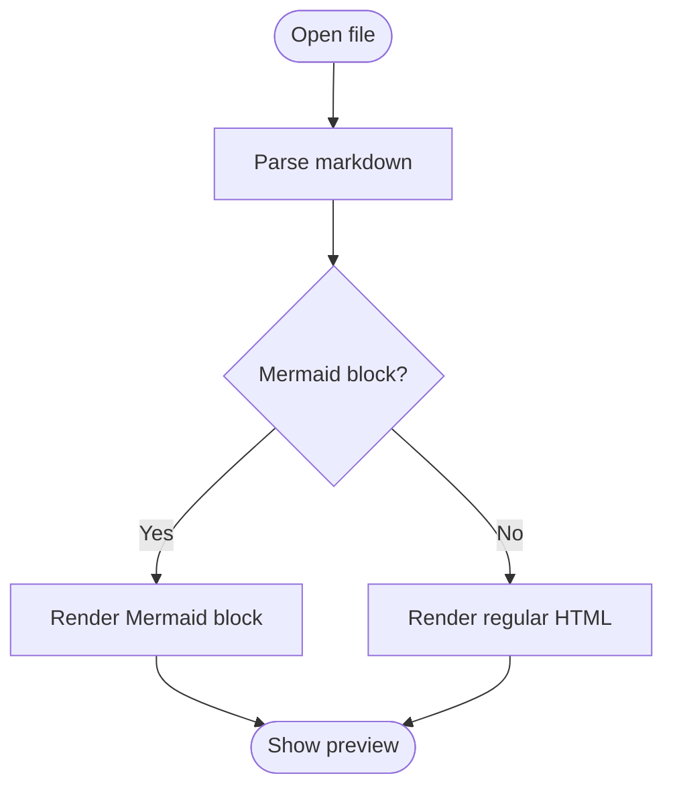

## Flowchart Left To Right

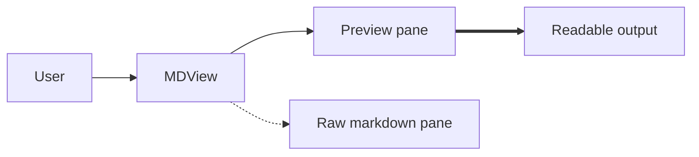

## Sequence Diagram

This sample intentionally mirrors the less common Mermaid fragment placed near the end of `test.md`.

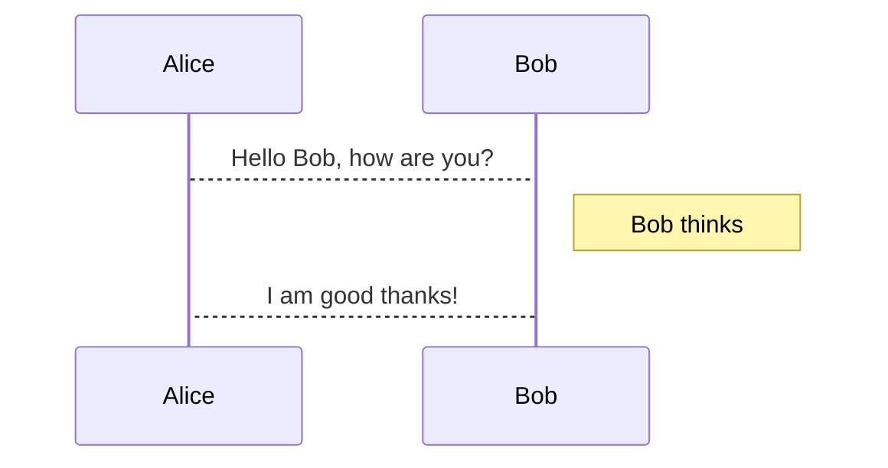

## Class Diagram

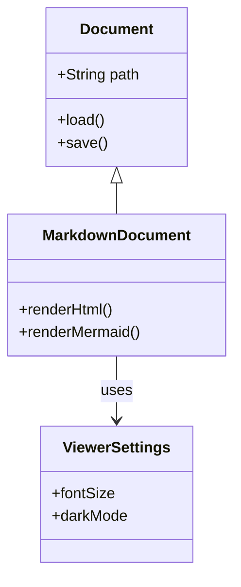

## State Diagram

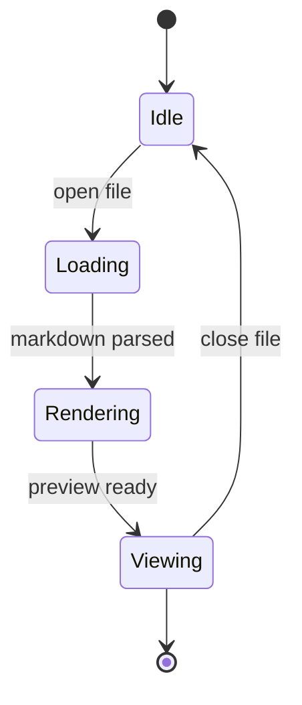

## Entity Relationship

```mermaid
erDiagram
    direction LR
    person["Customer Account"] {
        int account_id PK
        string? email UK "Optional contact address"
    }
    PURCHASE {
        int account_id PK, FK
        int order_id PK
    }
    person ||--|{ PURCHASE : places
    PURCHASE }o..o| COUPON : applies
    person only one to zero or more COUPON : receives
    COUPON |o..|| person : "was sent to"
    "Archived records"
```

## Requirements

```mermaid
requirementDiagram
    direction TB
    requirement "Offline reading" {
        id: R-01
        text: The reader can open a document when no network connection is available.
        risk: medium
        verifymethod: test
    }
    functionalRequirement preview {
        id: R-01.1
        text: Render the local document.
        risk: low
        verifymethod: inspection
    }
    element viewer {
        type: component
        docref: "Design guide §3"
    }
    "Offline reading" - contains -> preview
    preview <- satisfies - viewer
    viewer - traces -> "Offline reading"
```

## Gantt

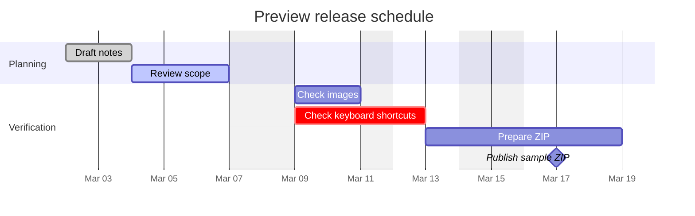

## Timeline

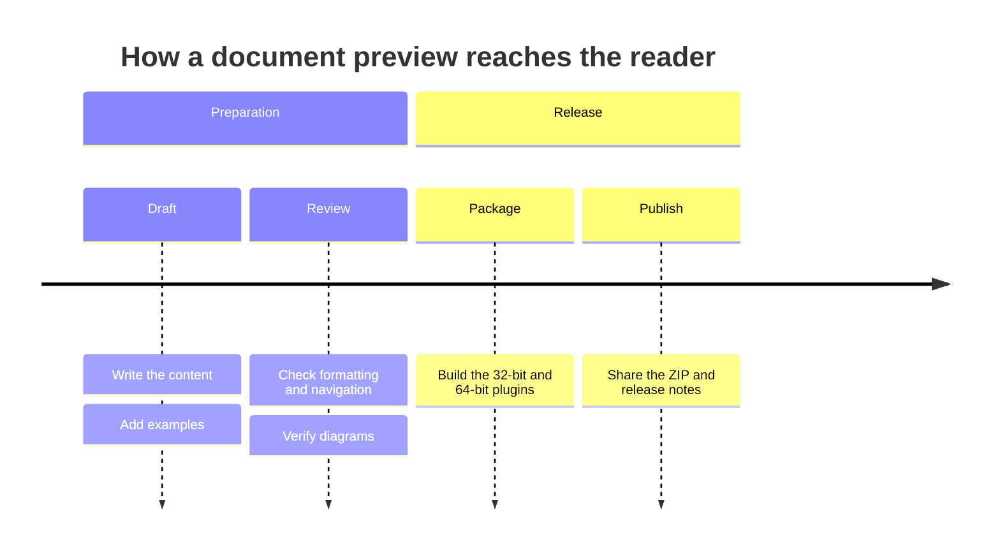

### Top-down timeline

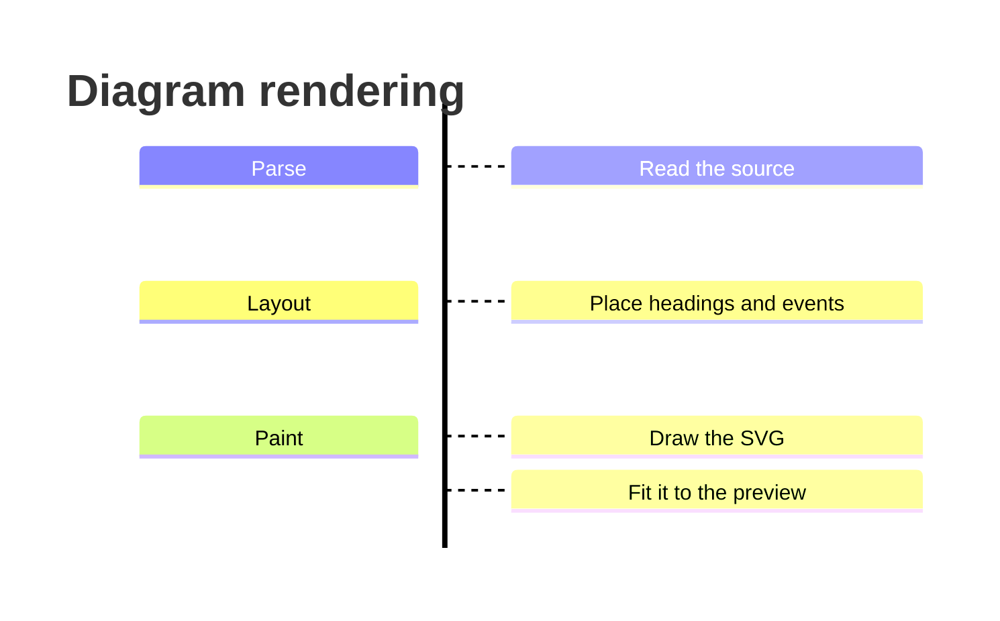

## Git graph

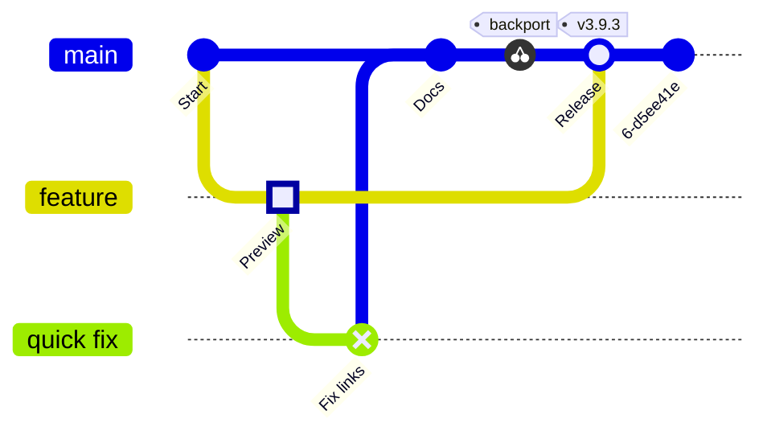

### Top-to-bottom Git graph

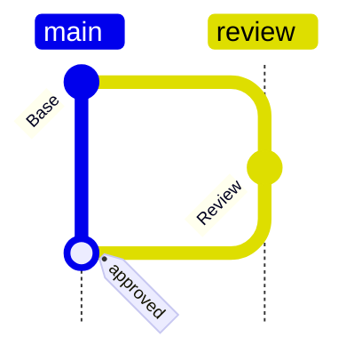

## Mind map

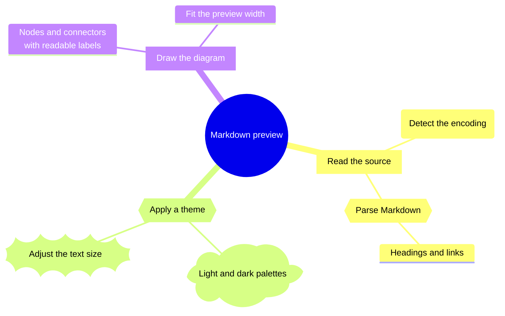

## Radar

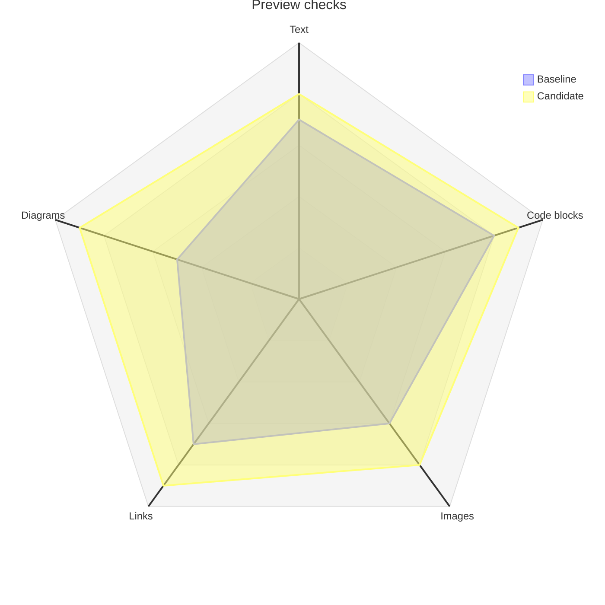

## Treemap

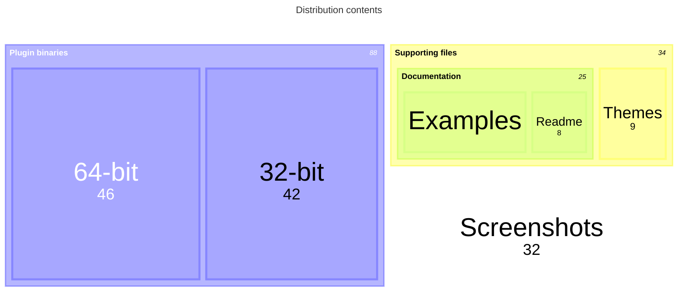

## Venn

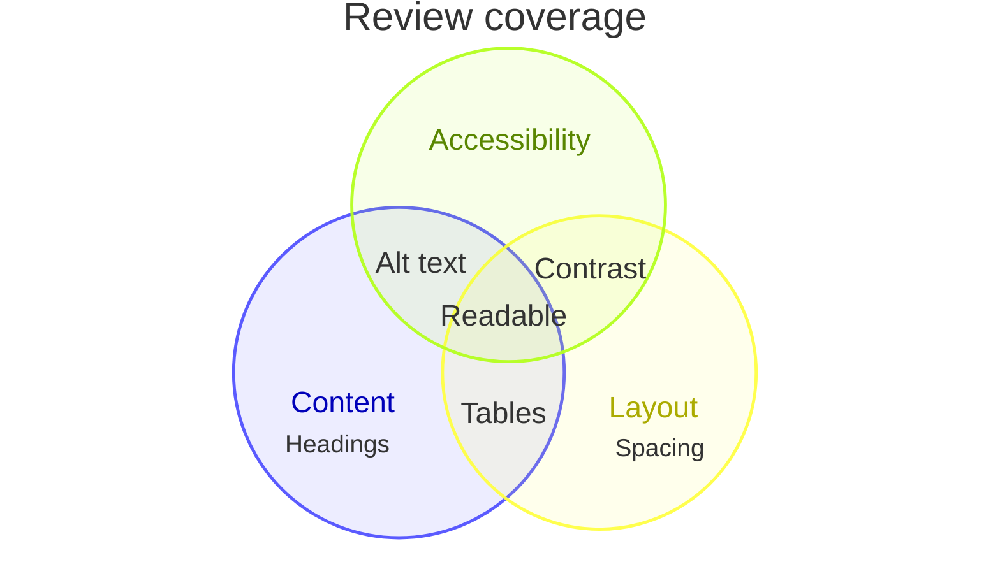

## Packet

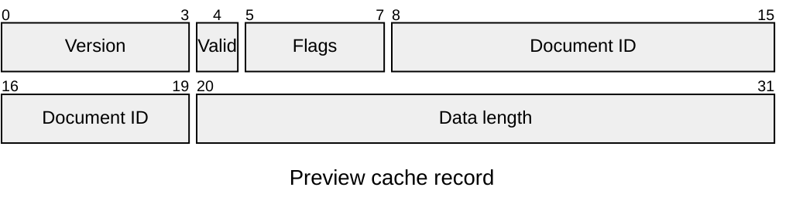

## ZenUML

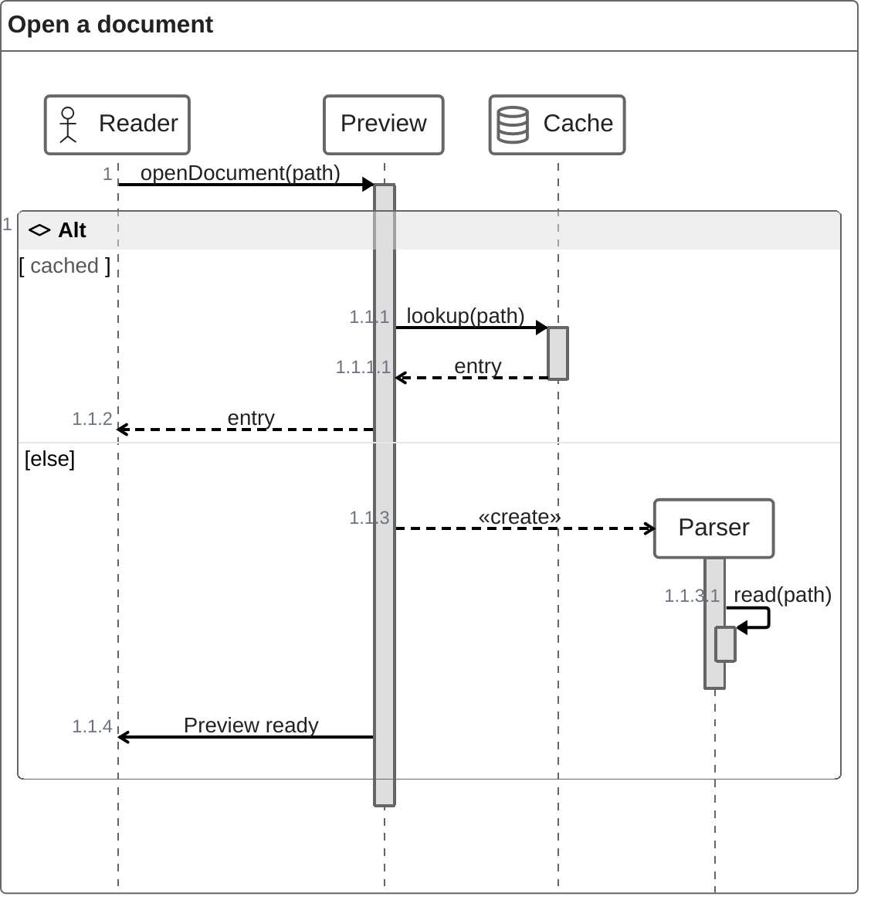

## Event Modeling


## Ishikawa

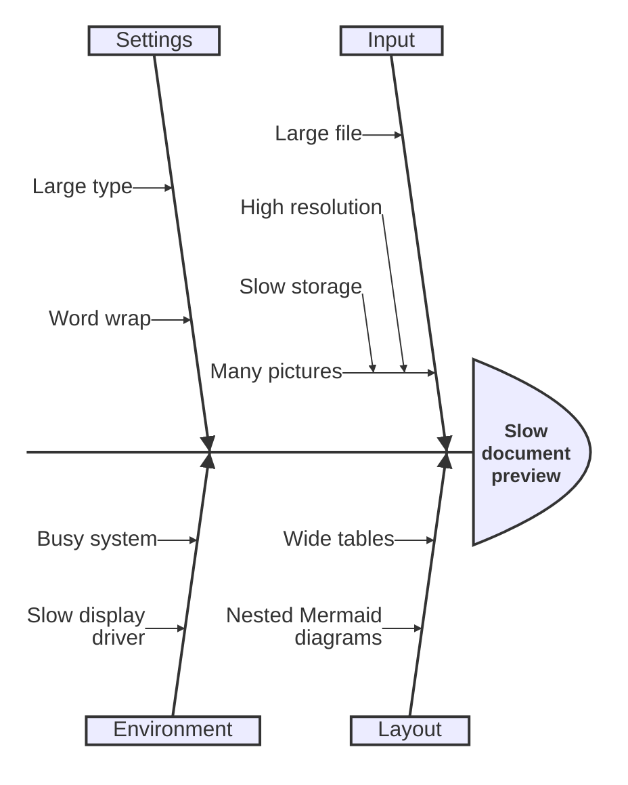

## Notes

- Mermaid rendering is self-contained inside the plugin binaries.
- Unsupported Mermaid syntaxes should fall back to the original source block.
